# StudyNest

A cosy study planner for Android, built for the Mobile Application Development course. Keep your subjects and
assignments in one place, run timed focus sessions, and watch your week come together.

<p>
  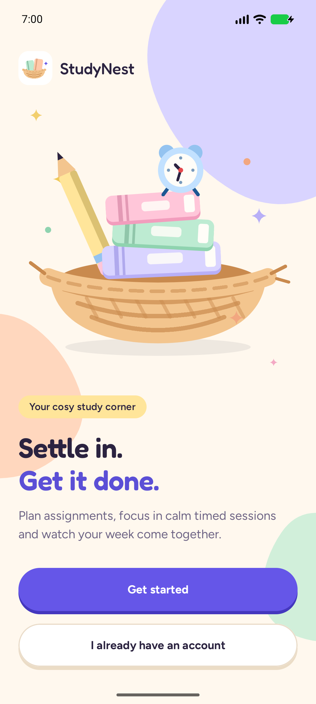
  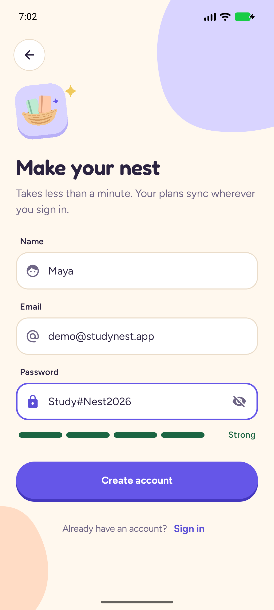
  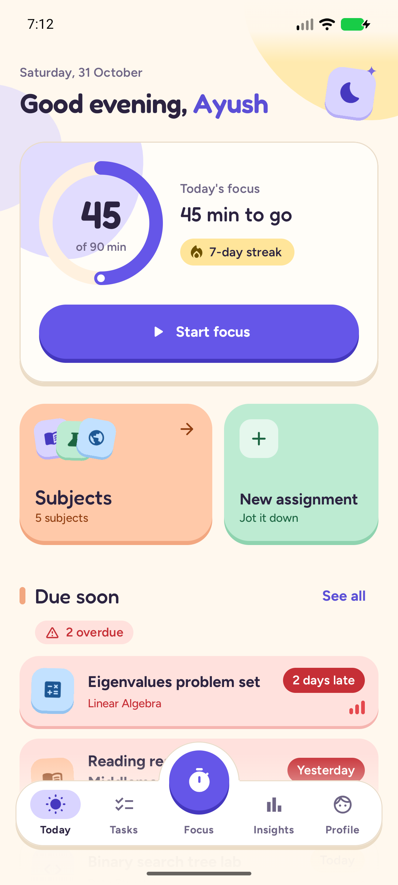
  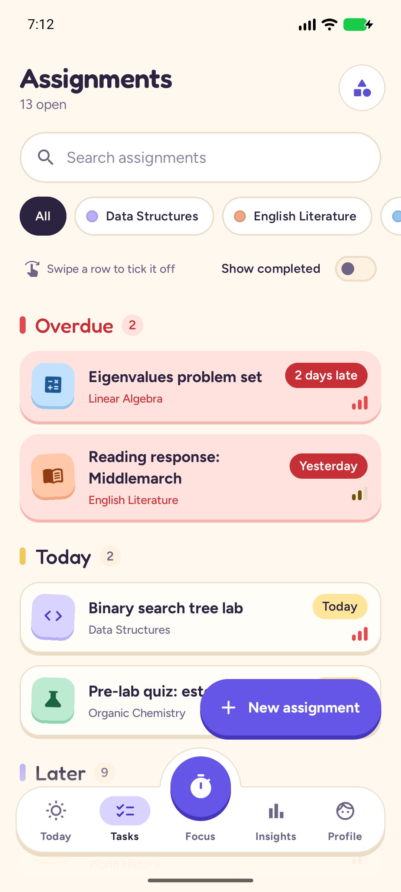
</p>
<p>
  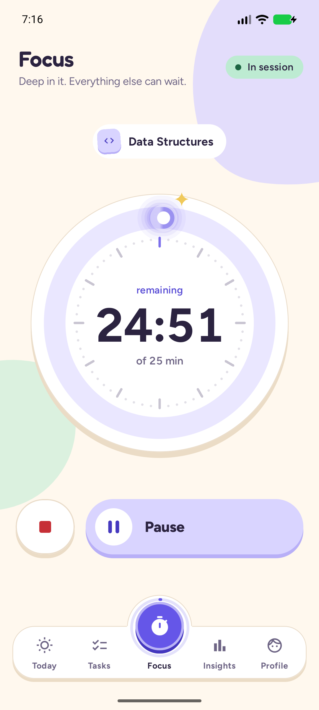
  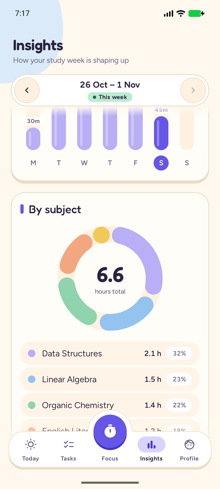
  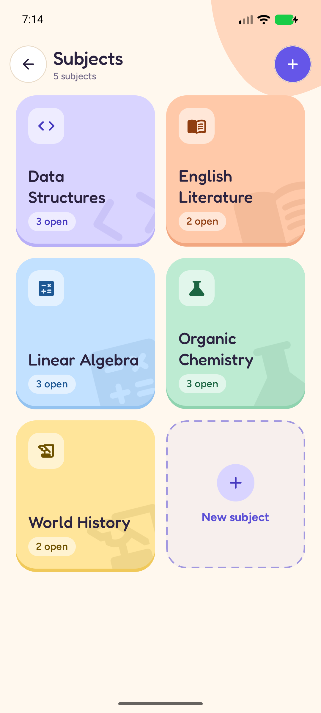
  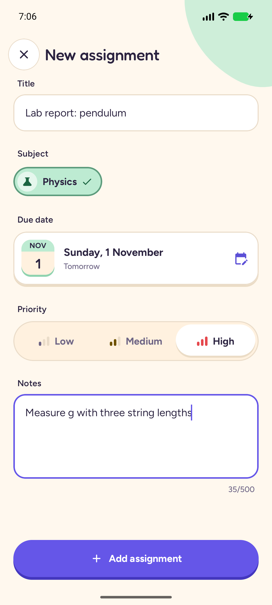
</p>
<p>
  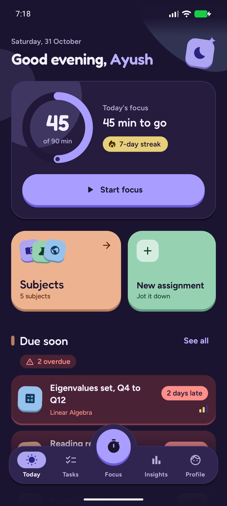
  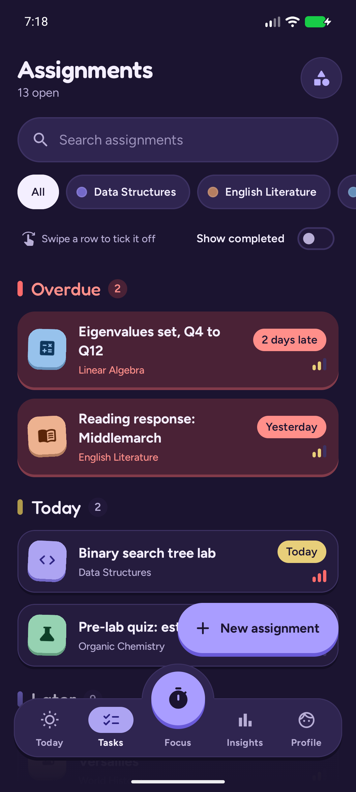
  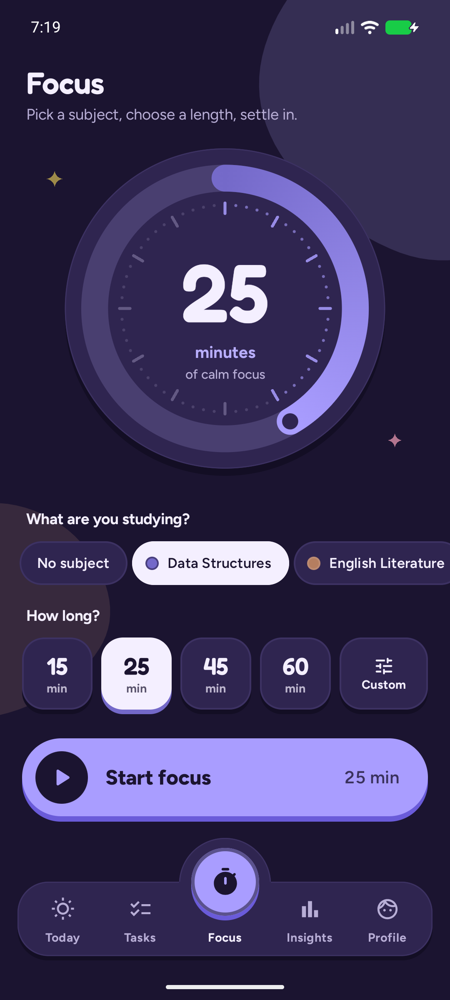
  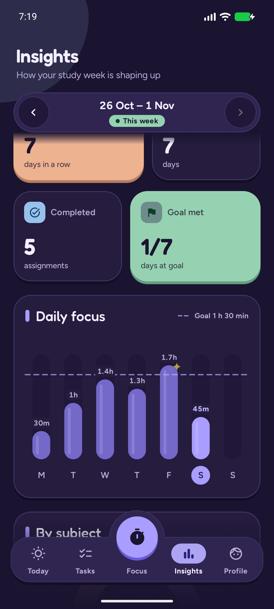
</p>

All 53 screenshots (light and dark, every screen and state) are in [`artifacts/screenshots/`](artifacts/screenshots/), captured by the end-to-end run.

**Demo video:** [`artifacts/studynest-demo-2x.mp4`](artifacts/studynest-demo-2x.mp4) (2× speed, ~10 min) · full speed (~20 min):
[`artifacts/studynest-demo.mp4`](artifacts/studynest-demo.mp4) — recorded on the release build by `scripts/record.sh`.
**Installable APK:** [`artifacts/StudyNest.apk`](artifacts/StudyNest.apk)

## Features

- **Welcome & accounts** — hand-drawn (Compose Canvas) welcome illustration; sign up / sign in with inline validation
  that appears after the first submit and then updates live, show/hide password, a password strength meter, a
  form-level error banner, loading buttons and keyboard-safe forms. The session survives restarts.
- **Today** — greeting with your first name and the date, a progress ring of today's focus minutes against your daily
  goal, your streak, a quick "Start focus" button, and "Due soon" assignments with overdue work highlighted. New
  accounts get a friendly empty state that walks them to their first subject. Pull to refresh.
- **Subjects** — a colourful grid of subjects (6 pastel colours × 10 icons) with open-assignment counts; add, edit and
  delete in a bottom sheet with a live preview.
- **Assignments** — grouped into Overdue / Today / This week / Later (and Done), filter chips per subject, search,
  a "show completed" toggle, swipe to mark done with an Undo snackbar, tap to edit.
- **Assignment editor** — title, subject picker, due date (Material date picker), priority, notes, delete with
  confirmation. It never saves defaults over an assignment that failed to load.
- **Focus timer** — pick a subject and 15 / 25 / 45 / 60 minutes or a custom length; a big animated ring fills as you
  study; pause, resume, stop. Finished sessions (and sessions stopped after at least a minute) are saved to the server.
  Time is computed from stored timestamps, so the timer stays correct in the background and even survives the app
  process being killed.
- **Insights** — total focus hours for the week, a daily bar chart with your goal line, a donut of time per subject
  (both custom Canvas), current and longest streak, assignments completed, days the goal was met, and a week switcher.
- **Profile** — initials avatar, name, email, daily focus goal editor (bottom sheet), sign out with confirmation.
- Light and dark themes (cream & pastel / deep plum), edge-to-edge, predictive back, spring animations.

## Tech stack

| Part | Technology |
|---|---|
| Android app | Kotlin, Jetpack Compose + Material 3 (Compose BOM 2026.09), AGP 9.5 with built-in Kotlin 2.4, Navigation 3, ViewModel + StateFlow, Retrofit 3 + kotlinx.serialization, OkHttp 5, DataStore, core-splashscreen |
| Design | Fredoka (display) + Figtree (UI, tabular numbers), both SIL OFL and bundled in `res/font`; charts, rings and illustrations drawn with Compose Canvas — no chart or image libraries |
| Session security | Bearer token encrypted with an AES-256-GCM key in the Android Keystore, stored in DataStore, excluded from backups |
| API server | Bun, Hono, Better Auth (email/password, signed bearer tokens, rate limiting), Zod validation |
| Database | PostgreSQL 18 (Docker) via Drizzle ORM, migrations with drizzle-kit |

Dependencies are wired by hand in `AppContainer.kt` (no Hilt) to keep the code easy to follow.

## Project structure

```
android/app/src/main/java/me/aysh/studynest/
├── AppContainer.kt      manual dependency injection
├── data/
│   ├── model/           domain models (Subject, Assignment, FocusSession, WeekInsights, Profile)
│   ├── remote/          Retrofit API, DTOs, mappers, error mapping (AppException)
│   ├── repository/      AuthRepository, StudyRepository (revision counter for reloads)
│   ├── session/         encrypted session store (Keystore AES-GCM + DataStore)
│   └── focus/           FocusTimer (timestamp-based, persisted)
├── ui/
│   ├── auth/ today/ subjects/ assignments/ editor/ focus/ insights/ profile/   screen + ViewModel each
│   ├── main/            bottom-bar shell
│   ├── components/      buttons, fields, chips, rings, sheets, states, decorations
│   ├── navigation/      Navigation 3 routes and root navigation
│   └── theme/           colours, type, shapes
└── util/                dates & weeks, durations, validation
server/
├── src/auth.ts          Better Auth configuration
├── src/app.ts           Hono app: security headers, body limit, auth proxy, error handling
├── src/routes/          subjects, assignments, focus sessions + insights, me
├── src/db/              Drizzle schema, migrate and seed scripts
├── drizzle/             SQL migrations
└── tests/               bun test suites (run against the studynest_test database)
scripts/
├── demo.py              end-to-end UI walkthrough with assertions and screenshots
└── record.sh            records the walkthrough into the demo videos
```

## Running it on a Mac

**You need:** [Docker Desktop](https://www.docker.com/products/docker-desktop/), [Bun](https://bun.sh)
(`curl -fsSL https://bun.sh/install | bash`) and [Android Studio](https://developer.android.com/studio).

**1. Database and API server**

```bash
docker compose up -d                 # Postgres 18 on 127.0.0.1:5433 (+ a studynest_test database)
cd server
cp .env.example .env
# put a real secret into .env:   BETTER_AUTH_SECRET=<output of: openssl rand -base64 32>
bun install
bun run db:migrate
bun run db:seed                      # demo account with sample data (see below)
bun run dev                          # API on http://localhost:8787
```

**2. The app**

1. Open the `android/` folder in Android Studio and let Gradle sync.
2. Create an emulator in Device Manager (a recent Pixel image) and press **Run**.
3. On Android 17 (API 37) and newer the app asks for permission to reach devices on your local network on first
   launch. Tap **Allow**: the API runs on your Mac, which the emulator reaches at `10.0.2.2`.

The API address comes from `studynest.apiUrl` in `android/gradle.properties` (default `http://10.0.2.2:8787/`).

### Demo account

| Email | Password |
|---|---|
| `demo@studynest.app` | `demo12345` |

Seeded with 5 subjects, 20 assignments (overdue, due today, this week, later and completed) and three weeks of focus
sessions. Re-run `bun run db:seed` to reset it.

## Tests

```bash
# Server: 100+ tests (auth, protected routes, CRUD + validation, user isolation, filters, insights maths, limits)
cd server && bun test && bunx tsc --noEmit

# Android: JVM unit tests (formatting, validation, weeks & due buckets, focus timer, repositories with MockWebServer)
cd android && ./gradlew testDebugUnitTest

# Android: debug + release builds (Kotlin warnings are treated as errors)
cd android && ./gradlew assembleDebug assembleRelease

# End to end on an emulator (server running, app installed, demo data seeded)
python3 scripts/demo.py
scripts/record.sh                    # builds release, reseeds, records artifacts/studynest-demo*.mp4
```

## Security notes

- **Auth:** Better Auth email/password with the `bearer` plugin (`requireSignature: true`), so only signed session
  tokens are accepted. Sign-in and sign-up are rate limited; the limiter only trusts a client-IP header that the Hono
  handler sets from the real socket address (any client-supplied copy is deleted). Emails are case-insensitive, names
  are validated (1–60 chars), and `dailyFocusGoalMinutes` can't be set during sign-up.
- **Authorization:** every app route requires a session and every query is scoped by the signed-in user's id;
  assignments and focus sessions can only reference the user's own subjects (no IDOR).
- **Input:** strict Zod schemas (unknown fields rejected, no defaults on PATCH), 16 KB body limit, LIKE wildcards
  escaped in search, consistent JSON errors `{ "error": { "code", "message" } }`, secure headers on every response.
- **App:** the token is encrypted with an Android Keystore AES-256-GCM key before it is written to DataStore, the
  session file is excluded from cloud backup and device transfer (`allowBackup=false`), and a 401 from the API only
  clears the session if it is still the token that was sent. Cleartext HTTP is allowed only for `10.0.2.2`,
  `localhost` and `127.0.0.1`.
- **Secrets:** `server/.env` is git-ignored; only `.env.example` (and a test-only `.env.test`) are committed. The dev
  server listens on `127.0.0.1` by default. Release builds are signed with the debug key for local demos only.

## Licenses

Fredoka and Figtree are licensed under the SIL Open Font License 1.1; the license texts ship in
`android/app/src/main/assets/licenses/`.
